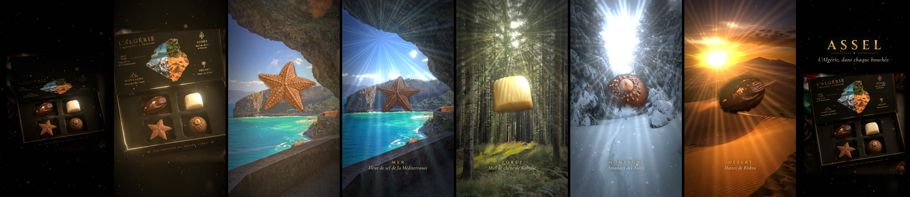
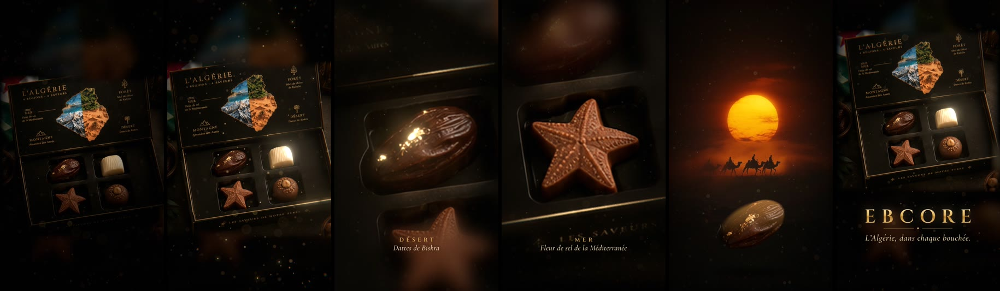

# ASSEL — « L’Algérie, dans chaque bouchée. »

Publicité de **20 secondes exactement** pour ASSEL, en **MP4 9:16 (1080×1920)** et **16:9 (1920×1080)**,
30 i/s, son AAC stéréo 48 kHz. Elle est construite à partir de **vos photos** : la boîte
« L’Algérie · 4 régions · 4 saveurs » et une photo par thème (mer, forêt, montagne, désert).



| Fichier | Contenu |
| --- | --- |
| `ad/export/assel-9x16.mp4` | Version verticale TikTok / Reels |
| `ad/export/assel-16x9.mp4` | Version horizontale |
| `ad/export/assel-soundtrack.wav` | Bande‑son seule |
| `ad/themes/` | Images des thèmes + `themes.json` (association image ↔ chocolat, légendes, lumière) |
| `ad/index.html` | Lecteur interactif (`?film=assel` par défaut, `?film=ebcore`, `?film=3d`) |

### Découpage

| Temps | Plan | Son |
| --- | --- | --- |
| 0–4 s | Noir, puis une lumière dorée révèle la boîte entrouverte ; une lueur chaude s’échappe de l’intérieur. Travelling avant et léger mouvement tournant (parallaxe). | Sub grave, souffle, battements, montée |
| 4–6 s | Le couvercle finit de s’ouvrir (léger rebond) ; un reflet doré balaie la boîte ; la caméra passe au‑dessus des chocolats. | Whoosh, charnière, impact à l’ouverture, scintillement |
| 6–9 s | L’étoile s’élève de son emplacement (l’emplacement vide apparaît dessous), puis **Mer** se révèle derrière elle. | Montée, impact, vagues |
| 9–12 s | Le chocolat blanc s’élève, **Forêt** apparaît derrière lui, avec du pollen dans les rayons. | Vent dans les arbres, oiseaux |
| 12–15 s | Le bonbon noisette/amande flotte devant **Montagne**, avec de la neige qui tombe. | Vent froid, cloches cristallines, darbouka |
| 15–18 s | La datte s’élève devant **Désert** : soleil, rayons, sable ; c’est le point culminant. | Oud en mode Hijaz, darbouka pleine |
| 18–20 s | Recul sur la boîte ouverte avec tous les chocolats ; logo **ASSEL** et slogan. | Silence d’un souffle, impact, accord, cloches |

Chaque chocolat reprend la couleur de la lumière de son image (bleu froid, vert doré, blanc neige,
orange désert). Il retourne dans son emplacement avant le suivant.

### Changer les images

Déposez les images dans `ad/themes/` et associez‑les dans `ad/themes/themes.json` (détails dans
`ad/themes/LISEZMOI.md`), puis `npm run render`. Les images ne sont jamais déformées : elles sont
seulement agrandies uniformément pour couvrir l’écran.

### Comment c’est fait

- **Couvercle** : son panneau intérieur est reprojeté par homographie pour le faire basculer jusqu’à
  l’ouverture complète. Derrière, la photo a été reconstruite sans le couvercle (`plate.jpg`).
- **Chocolats** : chacun est détouré dans la photo (`choc-*.png`). Les emplacements vides sont
  reconstruits par remplissage multi‑échelle (`tray-empty.jpg`), ce qui permet de soulever chaque
  chocolat en laissant voir son logement.
- Ressources générées par `python3 tools/prepare_assel.py BOITE.png`.

### Limites (en toute transparence)

- **Ce n’est pas une vidéo générée par IA** : c’est une animation de vos photos (compositing 2,5D),
  rendue image par image en MP4. La génération vidéo Higgsfield aurait coûté environ 35 crédits par
  plan de 5 s ; le compte connecté n’en avait que 9,88.
- **La boîte n’est jamais montrée fermée** : aucune photo de l’extérieur du couvercle n’était fournie.
  Le film la montre donc entrouverte, puis le couvercle termine son ouverture. Avec une photo de la
  boîte fermée (vue de face, même angle), l’ouverture complète devient possible.
- Les chocolats s’élèvent en restant de face (ce sont des photos) : ils flottent et s’inclinent
  légèrement, mais ne pivotent pas en 3D.
- La photo de la boîte est petite (623×624) : agrandie ×4 par super‑résolution, elle reste un peu
  douce en gros plan. Une photo haute définition, idéalement une par chocolat, améliorerait le rendu.
- Le logo est typographique (police Cinzel) : aucun fichier de logo ASSEL n’a été fourni. Il suffit de
  le fournir pour qu’il remplace le titre.
- Correspondance chocolat ↔ thème déduite des formes (étoile → Mer, blanc → Forêt,
  noisette → Montagne, datte → Désert), modifiable dans `themes.json`.

## EBCORE — 10 s



Publicité de **10 secondes exactement** pour EBCORE, chocolat premium inspiré de l’Algérie, en
**MP4 9:16 (1080×1920)** et **MP4 16:9 (1920×1080)**, 30 i/s, son AAC stéréo 48 kHz.

La version principale est construite à partir des **vraies photos** fournies : la boîte
« L’Algérie · 4 régions · 4 saveurs » et le coucher de soleil sur le Sahara. Les photos sont
animées en 2,5D (parallaxe par carte de profondeur, profondeur de champ, lumière, reflets sur les
dorures, particules) et montées sur une bande‑son composée et synchronisée à l’image.

### Fichiers

| Fichier | Contenu |
| --- | --- |
| `ad/export/ebcore-9x16.mp4` | Version verticale TikTok / Reels / Shorts (photos réelles) |
| `ad/export/ebcore-16x9.mp4` | Version horizontale (photos réelles) |
| `ad/export/ebcore-soundtrack.wav` | Bande‑son seule (16 bits, 48 kHz) |
| `ad/export/ebcore-3d-*.mp4` | Première version, entièrement en 3D procédurale |

### Découpage

| Temps | Plan | Image | Son |
| --- | --- | --- | --- |
| 0,0–2,0 s | **Le mystère** | Noir ; un halo de lumière chaude glisse sur le couvercle, les dorures s’allument une à une. Travelling avant lent, poussière de cacao. | Sub grave en ré, souffle qui monte |
| 2,0–4,0 s | **La révélation** | Un faisceau doré balaie la boîte et l’éclaire entièrement, puis la caméra plonge vers le chocolat‑datte, la mise au point se resserre. | Whoosh, coup sourd, scintillement doré, pulsation |
| 4,0–7,0 s | **Les quatre saveurs** | Quatre gros plans sur le temps, un par chocolat : Désert (dattes de Biskra), Mer (fleur de sel), Forêt (miel de chêne de Kabylie), Montagne (amandes des Aurès). | Un accent par plan, montée dans le mode Hijaz |
| 7,0–9,0 s | **La signature algérienne** | La photo du Sahara en arrière‑plan (soleil, caravane), légère brume de chaleur ; le chocolat‑datte flotte au premier plan. | Phrase d’oud en mode Hijaz, darbouka (maqsum), montée |
| 9,0–10,0 s | **Le plan final** | Packshot de la boîte, caméra qui se pose. Logo EBCORE et signature. | Une respiration de silence, puis impact grave + accord et cloches |

### EBCORE : ce qui est réel, ce qui ne l’est pas

- **Les images sont les vraies photos fournies**, agrandies par super‑résolution puis animées :
  mouvements de caméra, parallaxe, mise au point, lumière et reflets. Rien n’y est redessiné.
- **Pas de mouvement physique du produit.** À partir de photos fixes, la boîte ne peut pas s’ouvrir
  et les chocolats ne peuvent pas se briser ou couler. Ces actions demandent des plans filmés ou
  générés par IA vidéo (par exemple Higgsfield, ~35 crédits par plan de 5 s ; le compte connecté en
  avait 9,88).
- **Correspondance chocolat ↔ région déduite des formes** (datte → Désert, étoile → Mer,
  bonbon à la noisette/amande → Montagne, chocolat blanc → Forêt). À vérifier : elle se modifie dans
  `TOUR` (`ad/src/film-photo.js`).
- Les photos sources sont en basse définition (623×624 et 736×1313) : les gros plans restent un peu
  doux. Des photos haute définition de chaque chocolat amélioreraient directement le plan 3.
- La version 3D d’origine (`ebcore-3d-*.mp4`) utilise un packaging prototype, sans lien avec la
  vraie boîte.

## Lancer le projet

```bash
npm install
npm run preview          # lecteur temps réel → http://localhost:8080/
npm run render           # ASSEL : les deux MP4 + la bande-son dans ad/export/
npm run render:vertical  # ASSEL 9:16 seulement
node tools/render.mjs --film ebcore   # EBCORE (photos)
node tools/render.mjs --film 3d       # EBCORE (3D procédurale)
```

Prérequis de l’export : Node 18+, `ffmpeg` (libx264 + aac) et un Chromium.
Le script utilise le *headless shell* Playwright ; indiquez un autre binaire via `CHROMIUM_PATH=/chemin/vers/chrome`.
Le rendu passe par le moteur logiciel SwiftShader, il fonctionne donc aussi sans GPU (~3 s par image).

Les ressources de `ad/assets/` sont générées depuis les photos par
`python3 tools/prepare_assets.py BOITE.png SAHARA.jpg` (Pillow + NumPy). Les photos ont d’abord été
agrandies ×4 avec le modèle de super‑résolution EDSR d’OpenCV (`cv2.dnn_superres`).
Pour changer de photo de boîte avec un cadrage différent, ajustez les coordonnées en tête du script
(chocolats, couvercle) et les points d’intérêt `P` dans `ad/src/film-photo.js`.

Débogage : `ad/index.html?t=5.6&format=16x9` affiche une image fixe à l’instant voulu, et
`node tools/render.mjs --stills 2.5,5.6 --format 9x16 --out /tmp/stills` exporte des images PNG.

## Architecture

```
ad/
  index.html          lecteur (le son sert d’horloge maîtresse : l’image suit l’audio)
  src/film-assel.js   ASSEL 20 s : couvercle par homographie, chocolats qui s'élèvent, thèmes
  src/film-photo.js   EBCORE photo : calques 2,5D, cadrages, lumière, montage des 5 plans
  src/film.js         version 3D procédurale + shaders communs (particules, étalonnage)
  src/audio.js        bande-son synthétisée (OfflineAudioContext) + encodeur WAV
  src/title.js        carton final et légendes (typographie, balayage doré)
  assets/             photos préparées : boîte, flou, profondeur, masque des dorures, Sahara
  assets/assel/       chocolats détourés, boîte aux emplacements vides, boîte sans couvercle
  themes/             images des thèmes ASSEL + themes.json
  src/textures.js     textures procédurales : couvercle, étoile khatam, feuille d’or, normal maps
  src/util.js         easing, splines temporelles, bruit, PRNG déterministe
  fonts/              Cinzel & Cormorant Garamond (SIL Open Font License)
  vendor/three/       Three.js r169 (MIT)
tools/
  render.mjs          export image par image (Chromium headless → ffmpeg)
  serve.mjs           serveur statique du lecteur
  prepare_assets.py   génère ad/assets/ depuis les photos (EBCORE)
  prepare_assel.py    génère ad/assets/assel/ (détourages, emplacements vides, couvercle)
```

Toute l’animation est une fonction pure du temps (aléatoire à graine fixe) : le lecteur et l’export
produisent exactement les mêmes images, et la bande‑son est identique à l’échantillon près.
